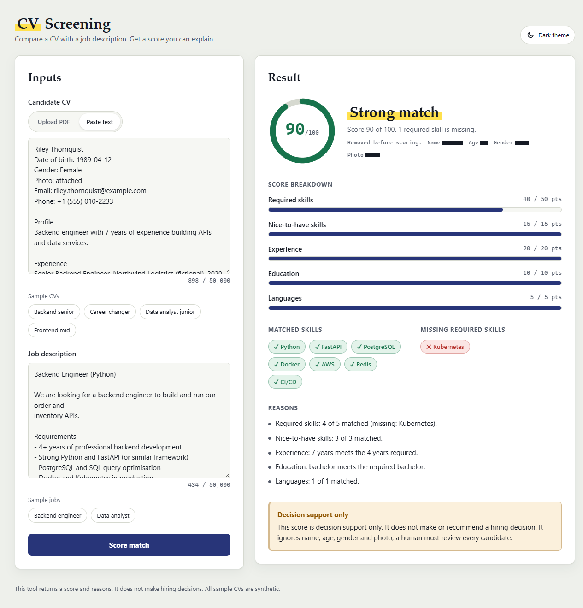

# CV Screening

A FastAPI service that compares a CV with a job description and returns an
**explainable match score** (0–100) with a per-component breakdown and plain-language reasons.

> The service does **not** make hiring decisions. It returns a score and reasons only,
> as decision support for a human reviewer.



*Web interface with a synthetic CV and job description. The screenshot was taken with a stubbed model client.*

## How it works

```
CV (text or PDF) ──► PDF text extraction ──► personal data removal ──► structured extraction ─┐
                                                                                                ├─► deterministic scoring ──► score + reasons
Job description ─────────────────────────────────────────────────────► structured extraction ─┘
```

1. **Parsing.** PDFs are read with `pypdf` as text only, so embedded images such as photos are never processed.
2. **Anonymization.** Before any text leaves the service, `app/parsing/anonymize.py` removes the name, date of birth and age, gender, pronouns, photo references, marital and family details, nationality, and contact details (email, phone, URLs).
3. **Extraction.** A language model (OpenAI API, model set by `LLM_MODEL`) turns the CV and the job description into structured data: skills, dated roles with the skills used in each, education level and languages. Years of experience are computed from the role dates in plain Python, not read by the model. The schemas contain no personal fields. Output is validated with Pydantic; invalid output is retried once.
4. **Scoring.** Plain Python, with no model involved, so the score is reproducible and unit-tested:

| Component           | Weight | Rule                                             |
|---------------------|-------:|--------------------------------------------------|
| Required skills     | 50     | share of required skills found in the CV         |
| Nice-to-have skills | 15     | share of optional skills found in the CV         |
| Experience          | 20     | `min(cv_years / required_years, 1)`              |
| Education           | 10     | full if the level is met, partial if below       |
| Languages           | 5      | share of required languages found                |

Skills are normalized (case, whitespace, aliases such as `JS → JavaScript` and `k8s → Kubernetes`).
A job skill also counts as matched when its word tokens appear as a contiguous sequence inside a CV skill:
CV `SQL query optimisation` satisfies job `SQL`. This works in one direction only, so a short CV skill never
satisfies a longer job skill (CV `Data` does not satisfy job `Data analysis`). Matching uses whole tokens, never
substrings, so `Java` never matches `JavaScript`, `Go` never matches `MongoDB`, and `C` never matches `C++`, `C#`
or `Objective-C`. When the CV wording differs, the reason names it, for example `SQL via SQL query optimisation`.
A small one-way implication map (`IMPLIES` in `app/scoring.py`) lets a specific CV skill satisfy a general job skill:
`PostgreSQL → SQL`, `FastAPI → Python`, `React → JavaScript`. It never works in reverse (CV `SQL` does not satisfy job
`PostgreSQL`) and never chains (`Next.js` satisfies `React`, not `JavaScript`). The reason reads `SQL via PostgreSQL`.
Component points stay as floats; the final score is rounded once to an integer.

## Fairness and limits

- Name, age, gender and photo are removed before extraction and are never part of the scoring input.
- Scoring is rule-based and transparent: every point can be traced to a line in `reasons`.
- Skill matching works on word tokens, aliases and the one-way implication map only. Related skills
  (for example Django vs FastAPI) do not count as matches.
- All CVs in this repository are synthetic (`data/synthetic/`). Do not commit real CVs.

## Cost control

- Every model call goes through the `LLMClient` interface and is cached on disk (`CACHE_DIR`, default `.cache/llm`).
- The cache key covers the model name, `PROMPT_VERSION`, the system prompt and the input. Changing a prompt and bumping `PROMPT_VERSION` invalidates old entries.
- Inputs are truncated to 12,000 characters before they are sent.

## Setup

Requires Python 3.12.

```bash
python -m venv .venv
source .venv/bin/activate          # Windows: .venv\Scripts\activate
pip install -e ".[dev]"
cp .env.example .env               # then set OPENAI_API_KEY
```

| Variable         | Default       | Description                     |
|------------------|---------------|---------------------------------|
| `OPENAI_API_KEY` | (empty)       | API key; required for `/match*` |
| `LLM_MODEL`      | `gpt-4o-mini` | Model used for extraction       |
| `CACHE_DIR`      | `.cache/llm`  | Disk cache for model responses  |

## Run

```bash
uvicorn app.main:app --reload
```

- Web interface: http://127.0.0.1:8000
- Interactive API docs: http://127.0.0.1:8000/docs

## Web interface

The page is plain HTML, CSS and JavaScript served by the same FastAPI app (`app/static/`).
There is no build step and it makes no external requests.

1. Open http://127.0.0.1:8000.
2. Add the CV in one of two ways:
   - **Upload PDF**: drop a PDF on the upload area or choose a file (text-based PDF, up to 5 MB).
   - **Paste text**: paste the CV text.
3. Paste the job description.
   To try it quickly, select one of the **Sample CVs** and **Sample jobs**. They are loaded from `data/synthetic/` through `GET /samples`.
4. Select **Score match**.

The result panel shows:

- a score gauge from 0 to 100: green for 70 and above, amber for 40–69, red below 40
- one bar per scoring component, with points earned out of the component weight
- matched skills (green) and missing required skills (red)
- the reasons behind every point, and the decision-support disclaimer

If something goes wrong, the panel says what happened and what to do next, for example:
- a scanned PDF with no text: paste the CV text instead
- a file that is too large
- a model or provider error
- no API key configured
- the server can't be reached

Other details:
- The page follows the system light or dark setting and has a theme toggle; the choice is remembered in the browser.
- It works on mobile and can be used with the keyboard alone.
- All text from the API is inserted as plain text, never as HTML.

### Examples

Text CV:

```bash
curl -s http://127.0.0.1:8000/match \
  -H "Content-Type: application/json" \
  -d "{\"cv_text\": \"Backend engineer, 5 years of Python and FastAPI. BSc Computer Science. English.\",
       \"job_text\": \"Backend engineer. Required: Python, FastAPI, PostgreSQL. 3+ years. Bachelor's degree.\"}"
```

PDF CV:

```bash
curl -s http://127.0.0.1:8000/match/pdf \
  -F "cv_file=@cv.pdf;type=application/pdf" \
  -F "job_text=<data/synthetic/jd_backend_engineer.txt"
```

Example response (shortened):

```json
{
  "score": 80,
  "breakdown": [
    {"name": "required_skills", "weight": 50.0, "ratio": 0.75, "points": 37.5,
     "detail": "Required skills: 3 of 4 matched (missing: Kubernetes)."}
  ],
  "matched_skills": ["Python", "FastAPI", "PostgreSQL", "Docker"],
  "missing_skills": ["Kubernetes"],
  "reasons": ["Required skills: 3 of 4 matched (missing: Kubernetes).", "..."],
  "disclaimer": "This score is decision support only. ..."
}
```

### Endpoints and errors

| Method | Path         | Body                                            |
|--------|--------------|-------------------------------------------------|
| GET    | `/`          | web interface (HTML)                            |
| GET    | `/samples`   | none; returns synthetic sample CVs and jobs     |
| GET    | `/health`    | none                                            |
| POST   | `/match`     | JSON `{cv_text, job_text}`                      |
| POST   | `/match/pdf` | multipart `cv_file` (PDF, ≤ 5 MB) + `job_text`  |

| Status | Meaning                                                          |
|--------|------------------------------------------------------------------|
| 413    | PDF larger than 5 MB                                             |
| 415    | uploaded file is not a PDF                                       |
| 422    | invalid input, invalid PDF, or `no extractable text` (scanned)   |
| 502    | model output still invalid after one retry, or provider error    |
| 503    | `OPENAI_API_KEY` not configured                                  |

## Tests

```bash
pytest
```

Tests use a fake model client and block all external network access, so they cost nothing and run offline.

## Docker

```bash
docker build -t cv-screening .
docker run -p 8000:8000 --env-file .env cv-screening
```

## Project layout

```
app/
  main.py          API routes and error mapping
  service.py       pipeline: anonymize → extract → score
  extraction.py    prompts, validation, retry, PROMPT_VERSION
  scoring.py       deterministic weighted scoring
  models.py        Pydantic models
  samples.py       read-only loader for the synthetic samples
  config.py        settings from .env
  llm/             LLMClient interface, OpenAI client, disk cache
  parsing/         PDF text extraction, anonymization
  static/          web interface: index.html, style.css, app.js
data/synthetic/    synthetic CVs and job descriptions
docs/              README screenshot
tests/             unit, API, frontend and end-to-end tests
```
